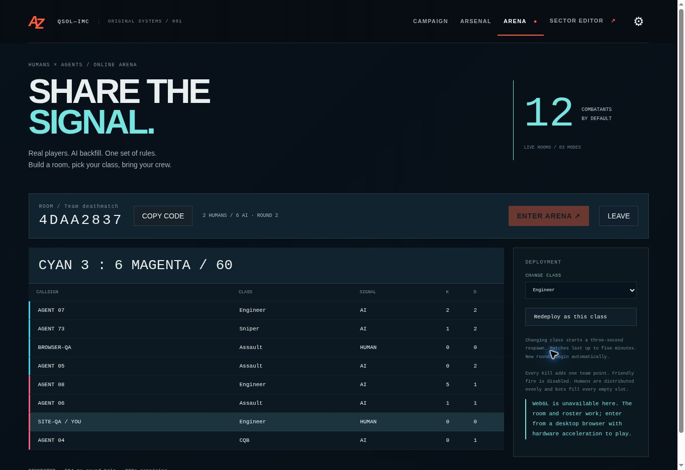

# Singapore deployment verification — 3 November 2026 (Adelaide)

Runtime commit: `857d08c8f8092b56fc334169799f9ecb2345c74f` (v0.4.3).

- PR #1 is merged. GitHub Actions run `41504523241` passed verification and Pages deployment.
- Render deployment `dep-dbkdngkipgvc73f9oaeg` is live in Singapore, one 0.5c-512mb instance with the approved 1 GB disk. No resource upgrade was made.
- GitHub Pages and the existing public Sites address both connect to `https://afterzero-arena.onrender.com/api/arena`.
- Sites version 8, source `c9a6e28f77a4a41423c06664add7bd580749fbca`, deployment `appgdep_6ae8dc5cff2881919081d2b108334103`, succeeded.
- The repository suite passed 103 tests, checks and build. The Sites shared suite passed 92 tests, checks and build.

## Live checks

Health/readiness and CORS preflight succeeded for both origins. Independent browser sessions on Pages and Sites joined the same eight-slot TDM room, one human on each team and six bots. Scores advanced and the room automatically entered its second round. A temporary HTTP client joined and left successfully. This proves shared backend connectivity and lifecycle behavior; it does not prove GPU combat or global capacity.

Observed browser RTT samples were 263, 266, 274, 297, 323 and 524 ms. These are spot readings from the cloud browser, not a distribution or measurements from the owner's network. Previous observations from that browser on the Sites/D1 backend were approximately 800–960 ms. The earlier standalone cloud-runtime sample also had timeouts and rejected late shots; worldwide latency and fairness are not established by the browser improvement.

The live gzip join payload used 1,877 encoded body bytes versus 6,574 decoded bytes. A sync payload used 1,502 versus 5,078 bytes (about 70% smaller). This excludes protocol overhead. The three HTTP actions returned 200. During the browser test, sampled CPU usage reached 0.321 CPU and memory approximately 63 MB; the instance has 0.5 CPU. Start with eight combatants. Multiple full rooms and sustained load have not been accepted, and no capacity guarantee is implied.

The cloud browser cannot create a WebGL context. GPU rendering, pointer-lock combat feel and the owner's expected Singapore ping need a GPU-capable player check.

## Budget controls and limits

The resource baseline is US$7.25/month, excluding applicable tax and usage charges. Hobby workspace; $0 extra build spending; automatic service deployment and Blueprint sync off; no autoscaling. Gzip responses and a persisted 3 GB application traffic allowance reduce outbound usage. The counter reserves 2 KiB overhead per response and survives restarts. Clients stop polling on exhaustion; Campaign and Forge remain available. This is not a Render-wide billing cap or a prepaid one-month purchase. See [the deployment notes](../RENDER.md) for exclusions and rollback.
